# Results

*Auto-generated by `clinical_project.py`.* Train rows: **55,976**, test rows: **13,994**.

## 1. Data cleaning steps

- Raw data: 101,766 rows x 50 columns
- Kept first encounter per patient: removed 30,248 repeat visits
- Removed expired/hospice patients: 1,545 rows
- Removed invalid gender rows: 3
- Dropped columns with >50% missing: ['weight']
- Dropped constant columns: ['examide', 'citoglipton', 'glimepiride-pioglitazone']
- Missing categorical values -> 'Unknown' / 'Not_tested' (numeric ones imputed inside the model pipeline)
- Added features: num_meds_used, num_meds_changed, total_prior_visits
- Clean data: 69,970 rows x 48 columns

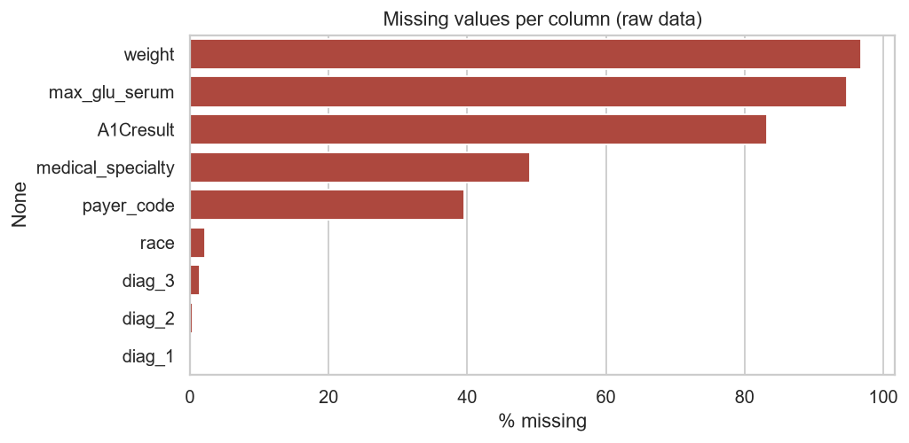

## 2. Class balance / imbalance check

Classification target: **any readmission (Yes/No)**. Imbalance ratio = **1.46 : 1**. Handled with `class_weight='balanced'` and threshold tuning (below).

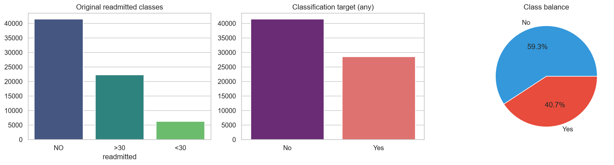

## 3. Skewness and kurtosis

Features with |skew| > 1 get a `log1p` transform inside the model pipeline.

| feature | skew_before | kurtosis_before | applied | skew_after | kurtosis_after |
|---|---|---|---|---|---|
| time_in_hospital | 1.1790 | 1.0120 | log1p | 0.1350 | -0.7500 |
| num_lab_procedures | -0.2200 | -0.2990 | - | -0.2200 | -0.2990 |
| num_procedures | 1.2280 | 0.5600 | log1p | 0.4520 | -1.1600 |
| num_medications | 1.4350 | 3.8560 | log1p | -0.4390 | 0.8300 |
| number_outpatient | 9.6990 | 185.0620 | log1p | 3.1530 | 10.6570 |
| number_emergency | 21.2290 | 1209.1320 | log1p | 4.2650 | 21.4810 |
| number_inpatient | 5.5870 | 47.3290 | log1p | 3.1350 | 10.2130 |
| number_diagnoses | -0.7250 | -0.3740 | - | -0.7250 | -0.3740 |
| age_num | -0.6340 | 0.3500 | - | -0.6340 | 0.3500 |
| num_meds_used | 0.6640 | 0.1900 | - | 0.6640 | 0.1900 |
| num_meds_changed | 1.6040 | 2.0750 | log1p | 1.3000 | 0.0180 |
| total_prior_visits | 6.6940 | 98.3720 | log1p | 1.9130 | 3.2870 |

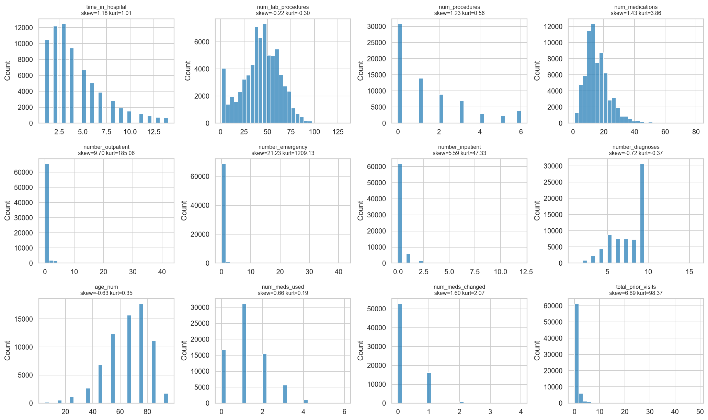

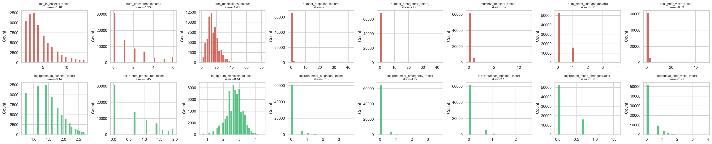

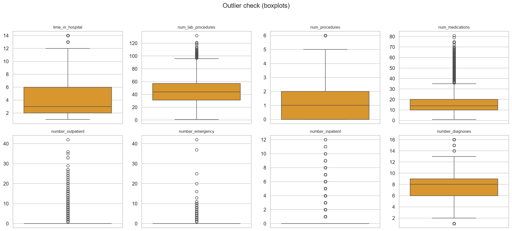

## 4. Correlation

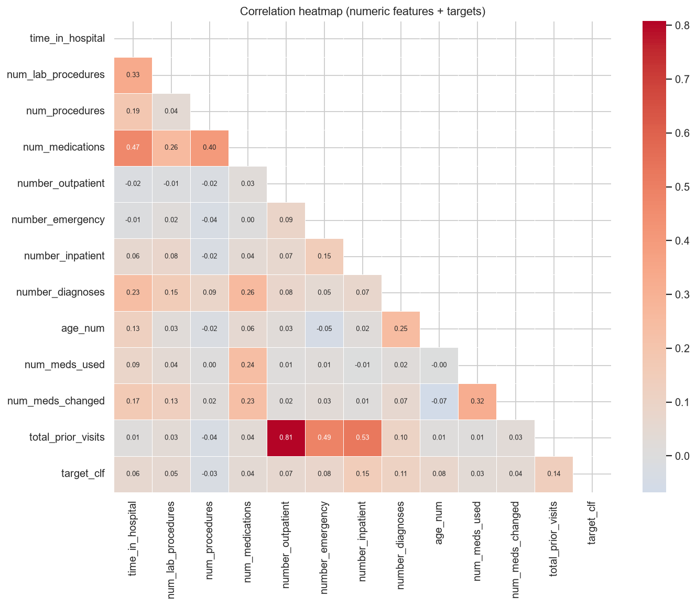

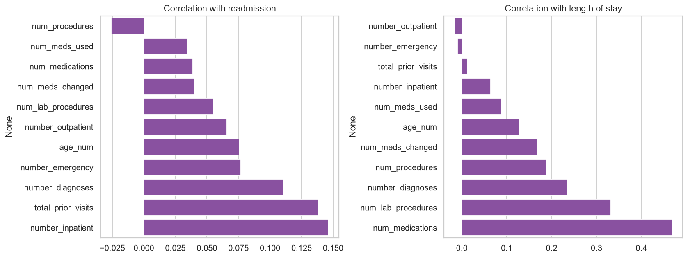

Highly correlated feature pairs (|r| >= 0.6) - tree models handle this well; Logistic/Ridge are regularised:

- `number_outpatient` vs `total_prior_visits`: r = 0.81

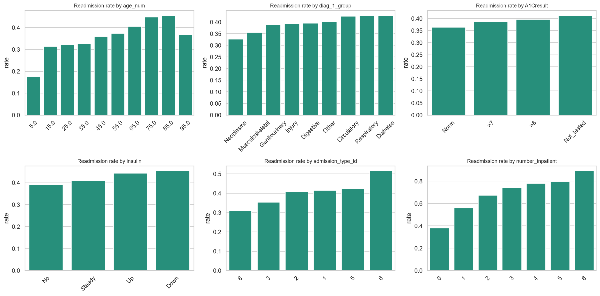

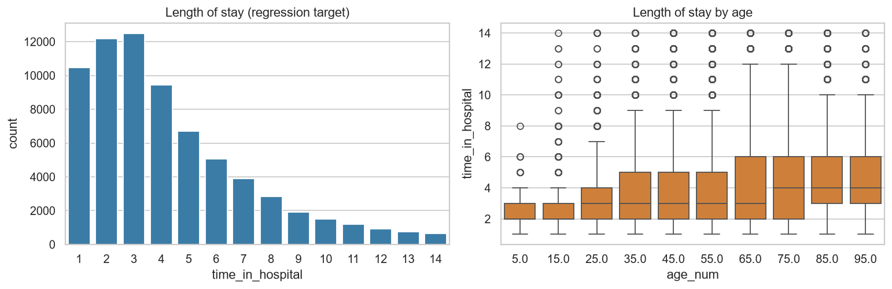

## 5. Classification results (test set, threshold 0.50)

| model | accuracy | balanced_acc | precision | recall | f1 | macro_f1 | roc_auc | pr_auc | cv_roc_auc | cv_std |
|---|---|---|---|---|---|---|---|---|---|---|
| Baseline (always majority) | 0.5927 | 0.5000 | 0.0000 | 0.0000 | 0.0000 | 0.3721 | 0.5000 | 0.4073 | 0.5000 | 0.0000 |
| Logistic Regression | 0.6090 | 0.6047 | 0.5178 | 0.5818 | 0.5479 | 0.6017 | 0.6489 | 0.5501 | 0.6509 | 0.0042 |
| Random Forest | 0.6086 | 0.6046 | 0.5174 | 0.5830 | 0.5482 | 0.6015 | 0.6488 | 0.5528 | 0.6518 | 0.0022 |
| Hist Gradient Boosting | 0.6174 | 0.6174 | 0.5259 | 0.6174 | 0.5679 | 0.6123 | 0.6661 | 0.5662 | 0.6632 | 0.0023 |
| XGBoost | 0.6196 | 0.6194 | 0.5282 | 0.6184 | 0.5698 | 0.6144 | 0.6683 | 0.5698 | 0.6665 | 0.0026 |
| Hist Gradient Boosting (tuned) | 0.6167 | 0.6165 | 0.5252 | 0.6153 | 0.5667 | 0.6115 | 0.6666 | 0.5674 | 0.6653 | 0.0028 |

**Best model:** XGBoost

### Threshold tuning (precision / recall balance)

| setting | threshold | accuracy | balanced_acc | precision | recall | f1 | macro_f1 | roc_auc | pr_auc |
|---|---|---|---|---|---|---|---|---|---|
| default 0.50 | 0.5000 | 0.6196 | 0.6194 | 0.5282 | 0.6184 | 0.5698 | 0.6144 | 0.6683 | 0.5698 |
| tuned | 0.5150 | 0.6269 | 0.6194 | 0.5391 | 0.5789 | 0.5583 | 0.6177 | 0.6683 | 0.5698 |

Precision-recall gap went from **0.090** (threshold 0.50) to **0.040** (tuned threshold 0.51).

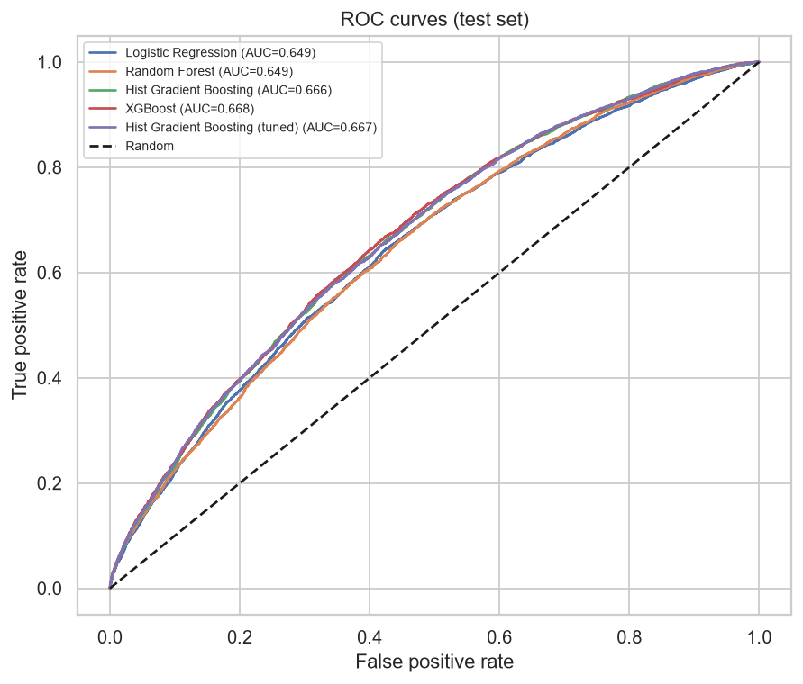

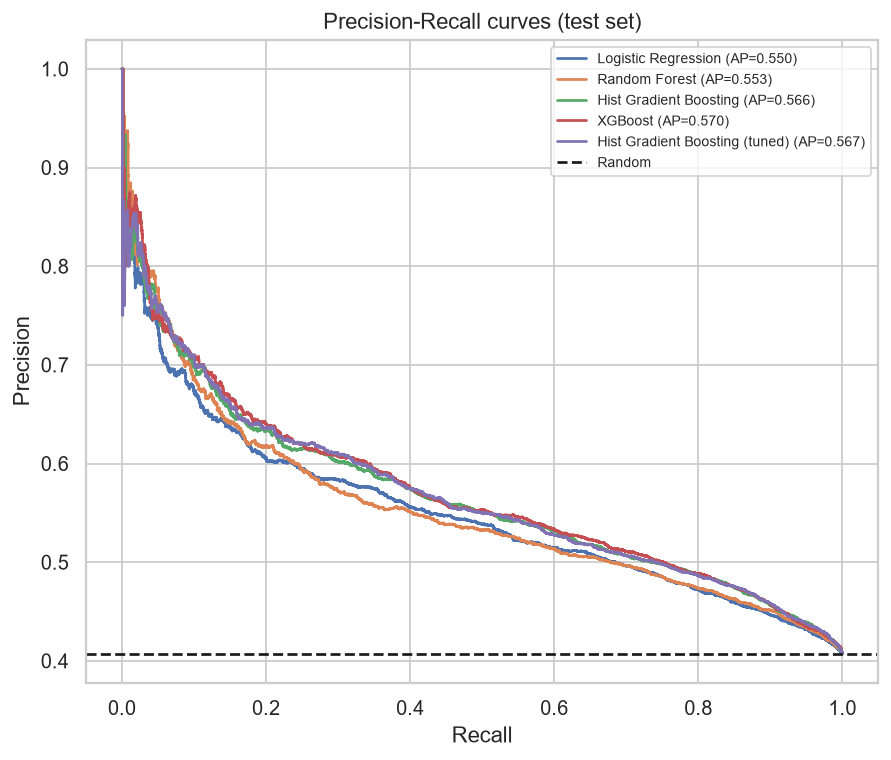

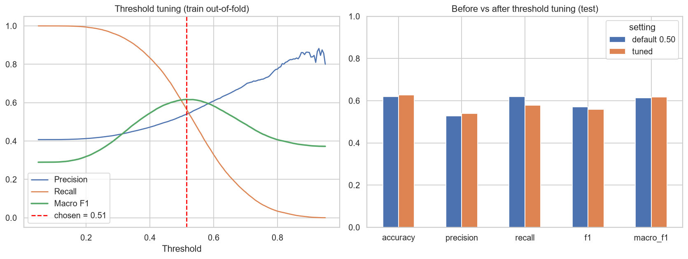

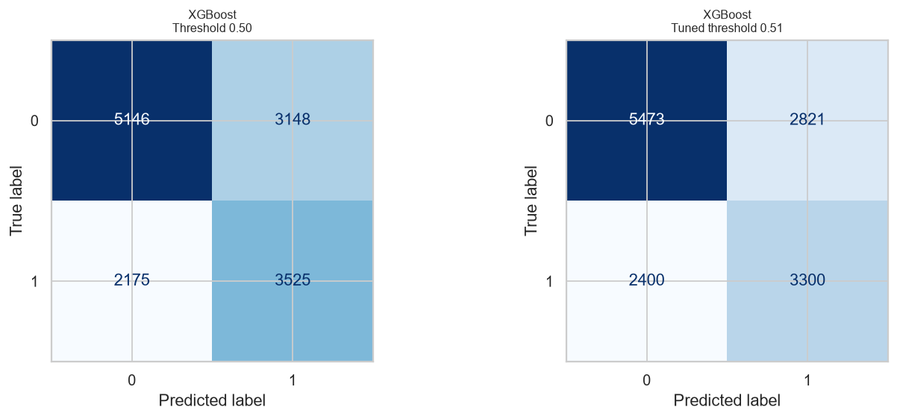

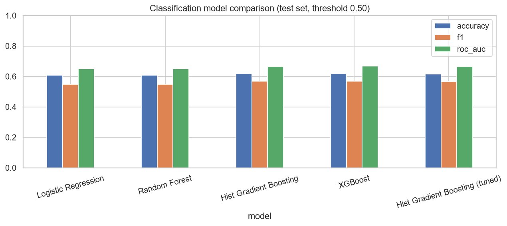

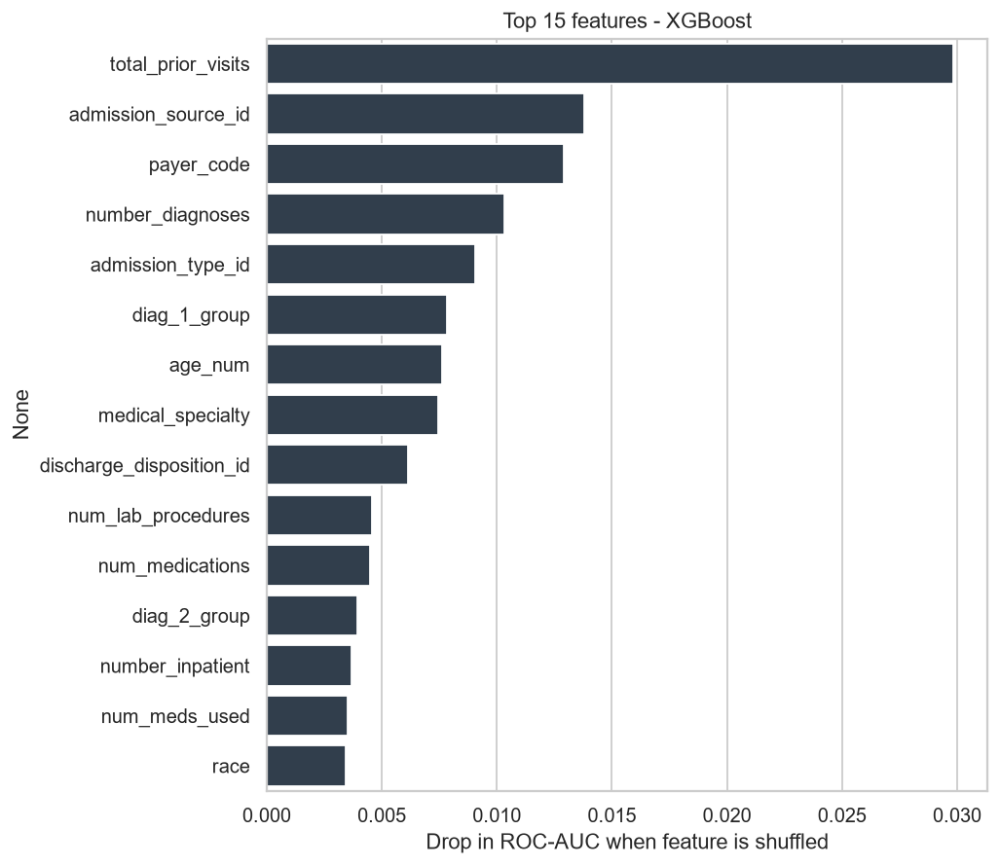

### Overfitting check (train vs test)

| set | accuracy | f1 | roc_auc |
|---|---|---|---|
| train | 0.6665 | 0.6034 | 0.7263 |
| test | 0.6269 | 0.5583 | 0.6683 |

### 95% confidence intervals (bootstrap, test set)

| metric | estimate | ci_low | ci_high |
|---|---|---|---|
| accuracy | 0.6269 | 0.6197 | 0.6361 |
| f1 | 0.5583 | 0.5484 | 0.5679 |
| macro_f1 | 0.6177 | 0.6105 | 0.6268 |
| roc_auc | 0.6683 | 0.6607 | 0.6773 |

### Calibration and risk deciles
Brier score: **0.2275**. Class weights shift predicted values upwards, so the model output is a *risk score* (good for ranking patients), not an exact probability.

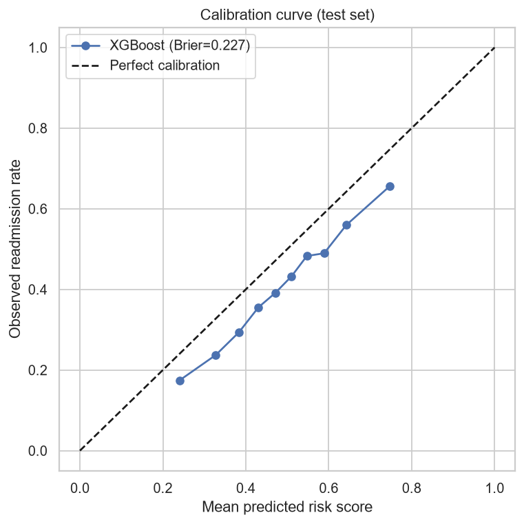

| decile | patients | readmit_rate | avg_risk_score | lift |
|---|---|---|---|---|
| 1.0000 | 1400.0000 | 0.1743 | 0.2401 | 0.4279 |
| 2.0000 | 1399.0000 | 0.2373 | 0.3276 | 0.5826 |
| 3.0000 | 1399.0000 | 0.2938 | 0.3836 | 0.7213 |
| 4.0000 | 1400.0000 | 0.3557 | 0.4307 | 0.8733 |
| 5.0000 | 1399.0000 | 0.3917 | 0.4716 | 0.9617 |
| 6.0000 | 1399.0000 | 0.4325 | 0.5102 | 1.0617 |
| 7.0000 | 1400.0000 | 0.4829 | 0.5472 | 1.1855 |
| 8.0000 | 1399.0000 | 0.4896 | 0.5889 | 1.2021 |
| 9.0000 | 1399.0000 | 0.5597 | 0.6424 | 1.3741 |
| 10.0000 | 1400.0000 | 0.6557 | 0.7468 | 1.6098 |

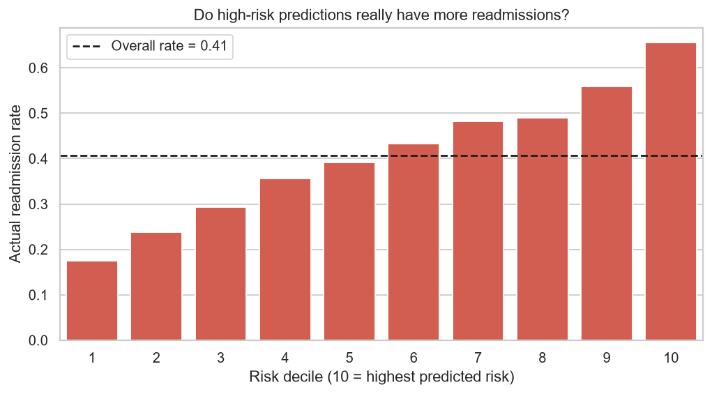

### Fairness check by subgroup

Performance should be similar across groups; big gaps would mean the tool is unfair.

| group | value | n | actual_rate | accuracy | precision | recall | roc_auc |
|---|---|---|---|---|---|---|---|
| gender | Male | 6535 | 0.3960 | 0.6237 | 0.5235 | 0.5549 | 0.6606 |
| gender | Female | 7459 | 0.4172 | 0.6297 | 0.5518 | 0.5990 | 0.6741 |
| race | Caucasian | 10520 | 0.4182 | 0.6216 | 0.5420 | 0.6135 | 0.6669 |
| race | Hispanic | 281 | 0.3345 | 0.6726 | 0.5119 | 0.4574 | 0.7048 |
| race | AfricanAmerican | 2483 | 0.3971 | 0.6279 | 0.5340 | 0.4939 | 0.6556 |
| race | Unknown | 388 | 0.2964 | 0.6985 | 0.4833 | 0.2522 | 0.6781 |
| race | Asian | 103 | 0.3107 | 0.6796 | 0.4783 | 0.3438 | 0.7011 |
| race | Other | 219 | 0.3379 | 0.6621 | 0.5000 | 0.4189 | 0.6706 |
| age_group | 60-79 | 6679 | 0.4279 | 0.6131 | 0.5411 | 0.6316 | 0.6552 |
| age_group | 80+ | 2601 | 0.4394 | 0.5886 | 0.5243 | 0.6903 | 0.6374 |
| age_group | 40-59 | 3807 | 0.3719 | 0.6556 | 0.5476 | 0.4266 | 0.6807 |
| age_group | <40 | 907 | 0.3120 | 0.7178 | 0.5763 | 0.3604 | 0.7239 |

### SHAP
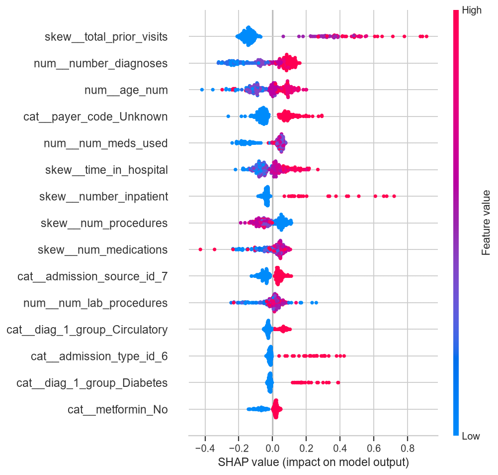

## 6. Regression results (length of stay, test set)

| model | MAE | RMSE | R2 | within_1_day_% | cv_R2 | cv_std |
|---|---|---|---|---|---|---|
| Baseline (predict mean) | 2.3094 | 2.9541 | -0.0000 | 23.3386 | 0.0000 | 0.0000 |
| Ridge (Linear) | 1.7505 | 2.3175 | 0.3846 | 37.8877 | 0.3707 | 0.0025 |
| Random Forest | 1.6836 | 2.2466 | 0.4217 | 38.8381 | 0.4149 | 0.0032 |
| Hist Gradient Boosting | 1.6234 | 2.1817 | 0.4546 | 41.3820 | 0.4497 | 0.0046 |
| XGBoost | 1.6291 | 2.1873 | 0.4518 | 40.9247 | 0.4476 | 0.0041 |
| Hist Gradient Boosting (tuned) | 1.6173 | 2.1775 | 0.4567 | 41.8322 | 0.4512 | 0.0045 |

**Best model:** Hist Gradient Boosting (tuned)

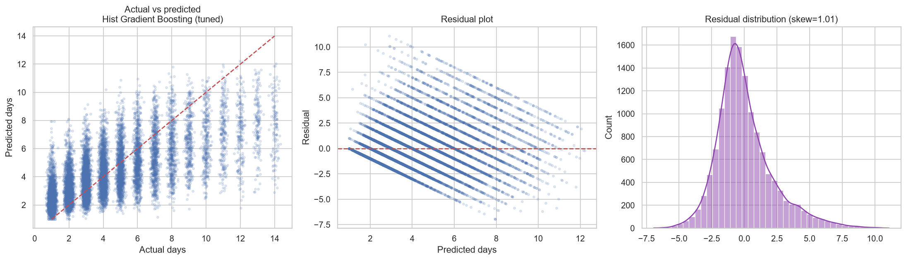

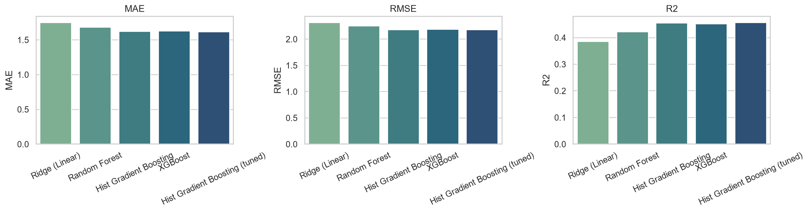

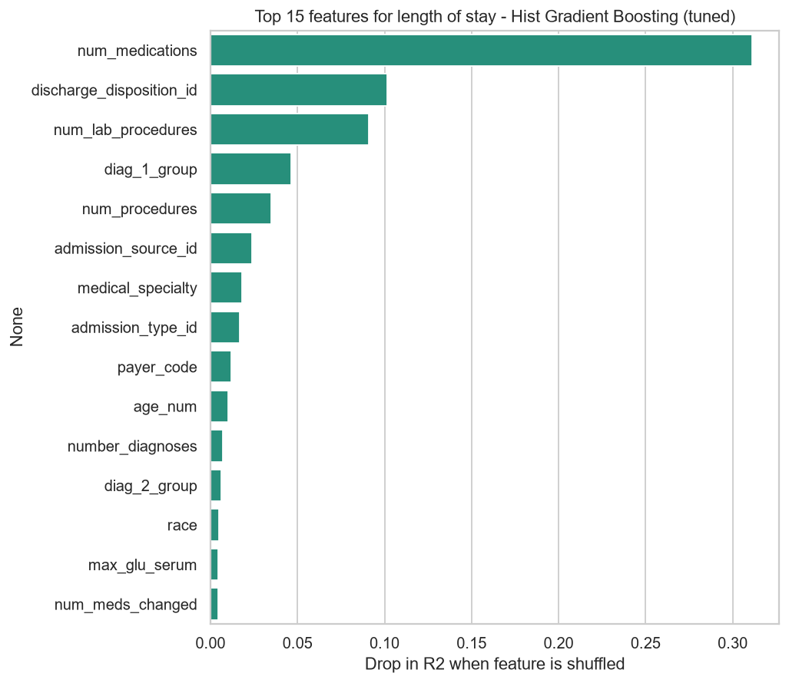

### Overfitting check and 95% confidence intervals

| set | MAE | R2 |
|---|---|---|
| train | 1.5416 | 0.5016 |
| test | 1.6173 | 0.4567 |

| metric | estimate | ci_low | ci_high |
|---|---|---|---|
| MAE | 1.6173 | 1.5942 | 1.6402 |
| RMSE | 2.1775 | 2.1453 | 2.2095 |
| R2 | 0.4567 | 0.4439 | 0.4696 |

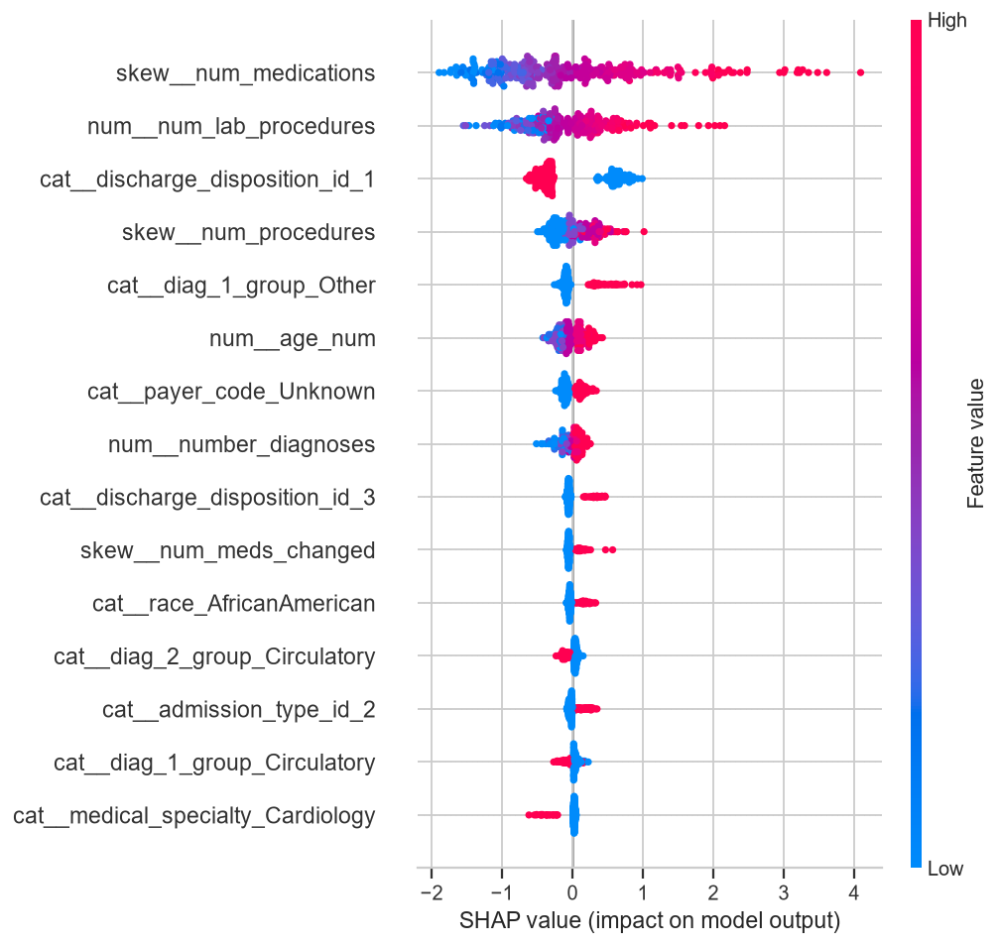

## 7. Summary

- Classification (any readmission (Yes/No)): best = **XGBoost**; accuracy **0.627**, F1 **0.558**, macro-F1 **0.618**, ROC-AUC **0.668** (tuned threshold 0.51).
- Regression (length of stay): best = **Hist Gradient Boosting (tuned)**; MAE **1.62 days**, RMSE **2.18**, R2 **0.457**, within 1 day: **41.8%**.